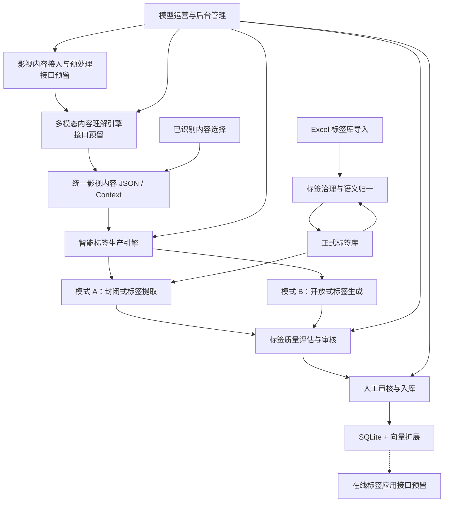

# 影视智能标签系统工程设计方案

## 1. 项目目标与设计范围

建设一套面向影视内容的离线智能标签生产平台，实现从多模态内容接入、标签生成、标签治理、质量评估到人工审核入库的完整闭环。

### 1.1 建设目标

- **统一数据标准：** 建立标准化影视内容 JSON 格式，统一封闭式提取和开放式生成的输入输出。
- **智能标签生产：** 支持从已有标签库提取标签，以及根据影视内容生成新标签。
- **标签体系治理：** 支持 Excel 标签库导入、自动检测、语义归一、去重和入库。
- **质量审核管理：** 提供统一后台，实现任务管理、标签审核、视频查看、置信度查看和审核入库。
- **统一数据存储：** 使用轻量级关系数据库及向量扩展，统一管理标签资产。

### 1.2 建设范围

| 模块 | 建设内容 | 实现方式 |
|---|---|---|
| 模块一：影视内容接入与预处理 | 视频接入、预处理、抽帧、ASR、OCR | 仅预留接口 |
| 模块二：多模态内容理解引擎 | 画面、台词、场景、剧情识别 | 仅预留接口 |
| 模块三：智能标签生产引擎 | 统一数据 JSON、上下文接口、两种标签生成模式 | 本期实现 |
| 模块四：标签治理与语义归一中心 | Excel 导入、标签检测、归一、入库 | 本期实现 |
| 模块五：标签质量评估与审核中心 | 后台管理、质量评估、人工审核 | 本期实现 |
| 模块六：标签资产与数据存储中心 | 关系数据、标签关系及向量存储 | 本期实现 |
| 模块七：智能标签搜索引擎 | 在线标签搜索、语义检索 | 仅预留接口 |
| 模块八：模型运营与反馈优化平台 | 模型管理、任务编排、视频接入、审核运营 | 本期实现 |

---

## 2. 总体工程架构

采用轻量级模块化架构，以离线标签生产为核心，统一管理内容上下文、标签体系、模型任务和标签资产。



系统提供两种内容入口：

1. **视频上传入口：** 上传影视视频，通过模块一、模块二的预留接口获取标准化内容 JSON，再进入标签生产流程。
2. **已有内容入口：** 直接选择已完成多模态识别的内容，跳过内容识别，进入标签生产流程。

两种入口统一使用模块三定义的数据标准和上下文接口。

## 3. 核心模块设计

### 3.1 模块一：影视内容接入与预处理（接口预留）

本期不实现视频解析、抽帧、ASR、OCR 等内部功能，仅定义标准接入接口。

| 接口 | 功能 |
|---|---|
| `POST /api/v1/media/ingest` | 提交视频文件及基础信息 |
| `GET /api/v1/media/tasks/{task_id}` | 查询接入及预处理任务状态 |
| `POST /api/v1/media/callback` | 接收预处理完成通知 |

输出：视频资源 ID、视频访问地址、基础元数据及后续识别所需资源信息。

### 3.2 模块二：多模态内容理解引擎（接口预留）

本期不实现 VLM、LLM、ASR、OCR 等识别能力，仅定义统一识别任务接口。

| 接口 | 功能 |
|---|---|
| `POST /api/v1/understanding/tasks` | 提交多模态识别任务 |
| `GET /api/v1/understanding/tasks/{task_id}` | 查询识别状态及结果 |
| `POST /api/v1/understanding/callback` | 接收识别完成通知 |

输出：影片摘要、场景信息、人物、事件、台词、画面描述及时间戳等标准化语义数据。

识别结果必须符合模块三定义的统一 JSON 数据规范。

### 3.3 模块三：智能标签生产引擎

系统核心模块，负责统一影视内容上下文，并提供两种标签生产模式。

#### 3.3.1 统一影视内容 JSON 格式

封闭式标签提取和开放式标签生成必须使用相同的数据输入格式。

```json
{
  "schema_version": "1.0",
  "asset": {
    "asset_id": "movie_001",
    "asset_type": "movie",
    "title": "示例电影",
    "duration_ms": 7200000,
    "video_uri": "file:///data/movie_001.mp4"
  },
  "content": {
    "summary": "影片整体剧情摘要",
    "scenes": [
      {
        "scene_id": "scene_001",
        "time_range": {
          "start_ms": 120000,
          "end_ms": 180000
        },
        "description": "两名人物在仓库中发生激烈争执",
        "visual_features": [
          "仓库",
          "夜晚",
          "多人对峙"
        ],
        "dialogues": [
          {
            "speaker": "角色A",
            "text": "你为什么要背叛我？",
            "start_ms": 125000,
            "end_ms": 128000
          }
        ],
        "entities": [
          {
            "entity_id": "person_001",
            "name": "角色A",
            "type": "character"
          }
        ],
        "events": [
          {
            "event_type": "conflict",
            "description": "人物之间发生激烈冲突"
          }
        ]
      }
    ]
  },
  "metadata": {
    "source": "multimodal_understanding",
    "model_version": "vlm_v1",
    "recognition_status": "completed"
  }
}
```

设计要求：

- 影片、剧集、场景使用统一的数据结构，通过 `asset_type` 和层级关系区分。
- 视频、图片等大文件只保存 URI，不直接传递文件二进制。
- 场景及台词保留时间戳，支持标签证据追溯。
- 识别数据支持增量扩展，通过 `schema_version` 管理格式变化。

#### 3.3.2 统一上下文接口

标签生产引擎负责将内容上下文、标签库上下文和生成策略统一组装成模型调用上下文。

```json
{
  "task_id": "task_001",
  "mode": "closed",
  "input_context": {
    "context_id": "context_001",
    "asset_id": "movie_001"
  },
  "tag_catalog_context": {
    "catalog_version": "v1.0",
    "candidate_tags": [
      {
        "tag_id": "tag_001",
        "tag_name": "悬疑",
        "tag_type": "genre",
        "description": "以悬念和谜题为核心的内容"
      }
    ]
  },
  "generation_policy": {
    "target_scope": ["movie", "scene"],
    "max_tags": 30,
    "min_confidence": 0.7
  }
}
```

上下文由系统动态构建，不要求调用方直接拼接完整标签库。

#### 3.3.3 模式 A：封闭式标签提取

目标：从已有标签体系中选择与影视内容最匹配的标签。

处理流程：

1. 根据影视内容语义召回候选标签。
2. 将候选标签及其定义注入模型上下文。
3. 模型判断内容与标签的相关性。
4. 输出标签 ID、相关性评分、置信度和证据。
5. 按策略过滤，生成待审核标签。

约束：仅允许从现有正式标签库中选择，不允许生成新的正式标签。

#### 3.3.4 模式 B：开放式标签生成

目标：根据影视内容自由生成语义标签，发现现有标签体系未覆盖的内容特征。

处理流程：

1. 输入统一影视内容 JSON。
2. 模型分析影片、场景、人物及事件语义。
3. 自由生成候选标签及其定义。
4. 进行标签语义去重和归一。
5. 匹配已有标准标签，无法匹配的形成新标签候选。
6. 输出待审核标签。

约束：新生成标签仅作为候选数据，必须经过模块四治理和模块五审核后才能进入正式标签库。

#### 3.3.5 统一标签输出格式

```json
{
  "task_id": "task_001",
  "asset_id": "movie_001",
  "mode": "closed",
  "tags": [
    {
      "tag_id": "tag_001",
      "tag_name": "悬疑",
      "tag_type": "genre",
      "origin": "catalog",
      "relevance_score": 0.93,
      "confidence": 0.91,
      "evidence": [
        {
          "scene_id": "scene_001",
          "start_ms": 120000,
          "end_ms": 180000,
          "description": "影片通过人物冲突及关键线索制造悬念"
        }
      ],
      "review_status": "pending"
    }
  ]
}
```

字段说明：

- `origin`：区分标准标签和模型生成标签。
- `relevance_score`：表示标签与内容的相关程度。
- `confidence`：表示模型对标签判断的置信度。
- `evidence`：记录支持标签判断的内容依据。
- `review_status`：记录标签审核状态。

两个评分采用 0～1 的统一数值范围，不默认代表经过概率校准的真实概率。

### 3.4 模块四：标签治理与语义归一中心

负责标签体系的统一管理，支持 Excel 标签库批量导入和自动治理。

#### 3.4.1 Excel 标签库导入

建议提供统一 Excel 模板：

| 字段 | 是否必填 | 说明 |
|---|---|---|
| tag_id | 否 | 标签唯一 ID，可由系统生成 |
| tag_name | 是 | 标签名称 |
| tag_type | 是 | 标签分类 |
| description | 是 | 标签语义定义 |
| parent_tag | 否 | 上级标签 |
| aliases | 否 | 同义词、别名 |
| applicable_scope | 否 | 适用范围 |
| status | 否 | 标签状态 |

#### 3.4.2 自动检测与入库流程

Excel 上传 → 格式解析 → 字段校验 → 重复检测 → 标签层级校验 → 自动归一 → 正式入库。

自动检测内容：

- 格式检测：字段缺失、数据格式错误。
- 重复检测：标签名称重复、别名冲突。
- 层级检测：父子标签关系错误、循环依赖。
- 分类检测：标签类型和适用范围是否合法。

处理策略：

- 校验通过且不存在冲突的标签：自动写入正式标签库。
- 疑似同义标签（语义检测）不自动拦截：直接放行入库，由人工甄别处理。
- 已存在标签：支持跳过、更新或人工确认合并。
- 全部导入操作保留批次号和变更记录，支持问题追溯。

#### 3.4.3 标签治理能力

- 标签标准化：统一名称、定义和分类。
- 标签语义归一：识别同义词及近义词。
- 标签去重：检测重复和相似标签。
- 标签层级管理：维护分类及父子关系。
- 标签版本管理：记录新增、修改、合并和停用历史。

### 3.5 模块五：标签质量评估与审核中心

提供统一后台管理页面，支持标签结果查看、质量评估和人工审核。

#### 3.5.1 后台管理页面

| 页面模块 | 核心功能 |
|---|---|
| 工作台 | 任务统计、待审核数量、生产成功率 |
| 标签库管理 | 标签查询、编辑、分类、层级管理 |
| 标签导入管理 | Excel 上传、导入结果、异常检测 |
| 标签生产任务 | 影片选择、模式选择、任务状态、任务详情 |
| 标签审核中心 | 标签列表、置信度、相关性、证据查看 |
| 内容详情 | 视频播放、场景时间轴、标签关联信息 |
| 质量评估中心 | 准确率、一致性、标签覆盖率等指标 |
| 模型配置中心 | 模型、Prompt、生产策略及版本管理 |

#### 3.5.2 标签审核页面

每条待审核标签至少展示：

- 影片名称、影片 ID、标签名称。
- 标签分类、标签来源。
- 标签相关性评分、模型置信度。
- 标签对应的视频场景和时间戳。
- 标签证据及模型判断说明。
- 当前审核状态。

审核操作：

- 通过：确认标签有效，允许入库。
- 拒绝：标记为无效，不进入正式标签关系。
- 修改：修正标签或分类后重新提交。
- 合并：将重复候选标签映射到已有标准标签。

支持批量审核和按置信度、标签类型、生成模式筛选。

#### 3.5.3 标签质量评估

支持以下质量指标：

- 标签准确率、Precision、Recall、F1。
- 标签生成一致性。
- 标签语义归一准确率。
- 新标签审核通过率。
- 标签证据覆盖率。
- 模型调用成功率、任务耗时及失败率。

### 3.6 模块六：标签资产与数据存储中心

采用轻量级统一关系数据库 + 向量扩展的存储架构，不单独引入图数据库和搜索引擎。

#### 3.6.1 技术选型

推荐方案：**SQLite + SQLite-Vector**。

设计特点：

- SQLite 负责关系数据、业务事务及结构化查询。
- SQLite-Vector 负责向量存储及相似度计算。
- 向量直接存放在普通数据表的 BLOB 字段中。
- 无需部署独立数据库服务。
- 视频、图片等大文件保存在本地文件系统或对象存储中，数据库仅保存 URI。

项目地址：https://github.com/sqliteai/sqlite-vector

后续多实例部署、较高并发写入或大规模向量检索时，可迁移至 PostgreSQL + pgvector。

#### 3.6.2 精简数据表设计

系统保留 8 张核心数据表（`media_context` 已并入 `media_asset`；
标签库在 v2 重建里拆成目录/标签两表，v1 混合表已删除）。

| 数据表 | 核心字段 | 主要职责 |
|---|---|---|
| `media_asset` | asset_id、asset_type、parent_id、title、video_uri、content_json、source、updated_at | 影片、剧集、场景基础信息与主内容 JSON |
| `tag_catalog` | dir_id、dir_name、dir_type、parent_id、applicable_scope、embedding | 标签**目录树**（静态/动态目录、可挂粒度、目录向量） |
| `tag_define` | tag_id、tag_name、tag_type、description、dir_id、aliases、status、embedding | 标签定义（val_fixed / val_generalized 预留） |
| `tag_generation_task` | task_id、asset_id、mode、model_version、status | 标签生产任务及执行记录 |
| `pre_asset_tag` | asset_id、target_type、target_id、tag_id、candidate_*、origin、review_status | 生成结果 + 审核队列（asset×tag 去重） |
| `asset_tag` | asset_id、target_type、target_id、tag_id、tag_name | 正式挂载（审核通过后复制；唯一键含 tag_name 为泛化值预留） |
| `tag_import_task` | task_id、file_name、status、result_summary | 标签文件导入任务（v1 `import_batch` 的 v2 语义名） |
| `prompt_template` / `user_account` | — | Prompt 版本化模板、审核后台账号 |

#### 3.6.3 核心表设计说明

**media_asset：影视资源表**

统一管理影片、剧集及场景，使用 `parent_id` 建立层级关系。影片行另存
`content_json`（上游模板形态的标准内容 JSON），是内容唯一数据源；
`source` 记内容口径（`asset_builder:v5-infer` / `asset_builder:v5-facts`），
`updated_at` 记最近一次写入内容的时间（场景行不存内容，两列恒为 NULL）。
v1 的 `media_context` 表已并入本表并删除。

**tag_catalog / tag_define：标签目录与标签定义（v2 起）**

标签库按 v2 拆成两张表：`tag_catalog` 是目录树（`dir_type` 静态/动态、
`applicable_scope` 声明该目录可挂的粒度 content/scene/character、
`parent_id` 自引用），`tag_define` 是挂在目录下的标签本体（`tag_type`
区分 val_fixed 固定值 / val_generalized 预留泛化值，`(dir_id, tag_name)`
唯一）。v1 的目录+标签混合表（`tag_catalog_v1`）与 `import_batch_v1` 已随
v2 重建删除，不再保留过渡表。

生成/召回/审核**直接读这两张表**（`library.load_library`，内容指纹做
版本号，改标签即失效向量索引）；入库动作也改成真写：新词通过插
`tag_define` + 记 `tag_change_log(create)`，合并别名追加到
`tag_define.aliases` + 记 `tag_change_log(update)`。`data/taglibrary/*.json`
与 `scripts/build_tag_library.py` 只作历史资料保留，运行期不再读取。

**tag_generation_task：标签生产任务表**

任务直接绑定资产（`asset_id` 非空外键），记录生产模式（closed / open）、
模型版本、Prompt 版本、参数及执行状态。同一资产可有多条任务；内容从
`media_asset.content_json` 读取，不再经 media_context 中转。

**pre_asset_tag：生成结果与审核队列表**

生成产出与人工审核共用一张表，`(asset_id, target_type, target_id, tag_id)`
与 `(asset_id, target_type, target_id, candidate_name)` 两个部分唯一索引保证
同一资产同一挂载点不重复。

- 挂载粒度：`target_type`（content / scene / character）+ `target_id`，本期只写
  content（`target_id = asset_id`），其余为结构预留。
- 标准标签：`tag_id` 关联库内标签（closed 全量；open 命中同义候选时写入）。
- 新词候选：`tag_id` 为空，先存 `candidate_name` / `candidate_description`，
  审核合入时补 `tag_id` 与 `candidate_dir_id`。
- 产出来源：`origin`（closed / open），不可变。
- 审核状态：`pending` / `approved` / `rejected`；审核人与备注直接落行内
  （`reviewer_id` / `review_comment`），不另建流水表。
- 标签证据：`evidence_json` 记录对应场景、台词及视频时间戳。

**asset_tag：正式挂载表**

审核通过的标签复制到此表，只留挂载关系与展示值（`tag_name` 冗余拷贝，
`tag_define` 改名/合并时同步刷新）；评分与证据留在 `pre_asset_tag`。
`ux_asset_tag(asset_id, target_type, target_id, tag_id, tag_name)` 唯一键含
`tag_name` 是为泛化值（同一标签挂多个实际值）预留。v2 重建已按此形状建表；
审核通过即复制一行。
`review_record` 表已删除（行即日志，审核人与备注落 `pre_asset_tag` 行内）。

**tag_import_task：标签导入任务表**

记录导入文件、状态、成功数量与异常摘要（v1 `import_batch` 改语义名，
列结构不变，`batch_id` → `task_id`）。

#### 3.6.4 数据精简原则

1. 标签别名直接以 JSON 数组存储在 `tag_catalog`（目录）/ `tag_define`（标签），
   暂不建设独立别名表。
2. 标签证据以 `evidence_json` 存在 `pre_asset_tag`，暂不建设独立证据表。
3. 标签向量存在 `tag_define.embedding`、目录向量存在 `tag_catalog.embedding`。
4. 内容向量不落库：`media_context` 已并入 `media_asset`，内容向量在生成任务
   启动时实时计算（不设缓存列）。
5. 生成结果与审核状态统一存在 `pre_asset_tag`，不再拆分候选表与挂载表。
6. 保留任务与导入批次，满足运行监控及数据追溯；审核历史由行内字段承载。

当未来出现多模型、多版本向量、单标签多证据记录或高频别名检索需求时，再将对应字段拆分为独立数据表。

### 3.7 模块七：智能标签搜索引擎（接口预留）

本期不实现在线搜索，仅预留未来调用接口及标签资产查询接口。

| 接口 | 功能 |
|---|---|
| `POST /api/v1/search/tags` | 自然语言标签搜索 |
| `GET /api/v1/assets/{asset_id}/tags` | 查询影视内容标签 |
| `GET /api/v1/tags/{tag_id}` | 查询标准标签信息 |

未来支持用户意图识别、标签语义映射、混合检索及相关性排序。

### 3.8 模块八：模型运营与反馈优化平台

作为统一任务入口和运营管理中心，负责模型调用、任务调度、视频测试及标签审核。

#### 3.8.1 两种任务入口

**入口 A：上传视频进行完整识别与打标**

```text
上传视频
  ↓
模块一：内容接入接口
  ↓
模块二：多模态理解接口
  ↓
生成统一影视内容 JSON
  ↓
模块三：智能标签生产
  ↓
模块四：标签治理
  ↓
模块五：标签审核
  ↓
审核通过，写入正式标签资产
```

说明：模块一和模块二本期仅提供接口适配，不开发内部识别能力。视频识别通过外部识别服务或后续接入的多模态服务完成。

**入口 B：选择已识别内容直接打标**

```text
选择已有识别结果
  ↓
读取统一影视内容 JSON
  ↓
模块三：智能标签生产
  ↓
模块四：标签治理
  ↓
模块五：标签审核
  ↓
审核通过，写入正式标签资产
```

支持选择封闭式标签提取或开放式标签生成。

#### 3.8.2 视频识别结果管理

识别成功后，后台支持：

- 在线播放原始视频。
- 按场景和时间戳查看视频片段。
- 查看多模态识别内容及结构化 JSON。
- 查看自动生成的标签列表。
- 查看每个标签的相关性评分和模型置信度。
- 查看标签对应的视频证据。
- 对标签执行通过、拒绝、修改和合并操作。
- 审核通过后将标签正式写入标签资产库。

#### 3.8.3 模型运营能力

- 模型统一接入：管理 VLM、LLM、Embedding 等模型。
- Prompt 管理：维护封闭式和开放式标签生成模板。
- 任务调度：支持批量任务、异步执行和失败重试。
- 任务监控：查看执行状态、耗时及模型调用情况。
- 版本管理：记录模型、Prompt、标签体系版本。
- 结果反馈：汇总人工审核及标签修正结果，用于后续优化。

---

## 4. 核心业务流程

### 4.1 标签库初始化流程

```text
上传 Excel 标签库
    ↓
解析标签及分类
    ↓
字段格式校验
    ↓
重复及语义相似检测
    ↓
标签层级和分类校验
    ↓
自动归一
    ↓
通过校验的数据自动入库
    ↓
形成正式标签库
```

### 4.2 离线标签生产流程

```text
选择影视内容
    ↓
构建统一上下文 JSON
    ↓
选择标签生产模式
    ├── 模式 A：封闭式标签提取
    └── 模式 B：开放式标签生成
    ↓
标签治理和语义归一
    ↓
标签质量评估
    ↓
后台人工审核
    ↓
审核通过
    ↓
正式标签数据入库
```

### 4.3 标签数据生命周期

```text
模型生成候选标签
    ↓
标签治理
    ↓
待审核标签
    ↓
人工审核
    ├── 通过 → 正式入库
    ├── 拒绝 → 不入库
    └── 修改 → 重新审核
```

---

## 5. 工程实施优先级

| 阶段 | 建设内容 | 主要交付 |
|---|---|---|
| 第一阶段 | 数据标准、数据库、Excel 标签库导入、标签治理 | 标准标签库 |
| 第二阶段 | 统一上下文接口、封闭式提取、开放式生成 | 标签生产引擎 |
| 第三阶段 | 后台管理、质量评估、标签审核和入库 | 标签管理后台 |
| 第四阶段 | 视频接入接口、识别服务适配、视频播放及结果查看 | 完整离线生产闭环 |
| 第五阶段 | 模型版本、Prompt 管理、任务监控和在线搜索接口预留 | 模型运营平台 |

## 6. 关键设计原则

1. **统一数据标准：** 所有内容入口统一转换为标准 JSON，避免模型和任务之间的数据格式不一致。
2. **生产与治理分离：** 模型只负责生成候选标签，正式标签必须经过治理及审核。
3. **封闭与开放协同：** 优先使用标准标签，开放式生成负责发现现有标签体系未覆盖的语义。
4. **证据可追溯：** 标签关联具体场景、台词及视频时间戳，支持人工核验。
5. **统一数据底座：** 采用 SQLite + 向量扩展，不引入独立图数据库和搜索引擎。
6. **模块解耦：** 视频预处理、多模态理解和在线搜索通过标准接口接入，支持后续独立扩展。
7. **轻量化部署：** 第一版采用模块化单体应用及后台任务执行器，避免过早引入复杂微服务和分布式基础设施。

**最终交付目标：** 建设一套轻量级离线智能标签生产平台，支持 Excel 标签库管理、影视内容接入、封闭式标签提取、开放式标签生成、标签质量审核及正式入库，并为未来在线标签搜索预留扩展接口。