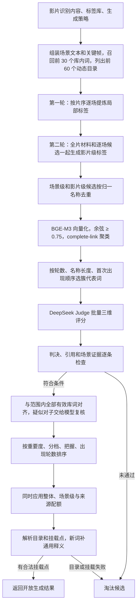
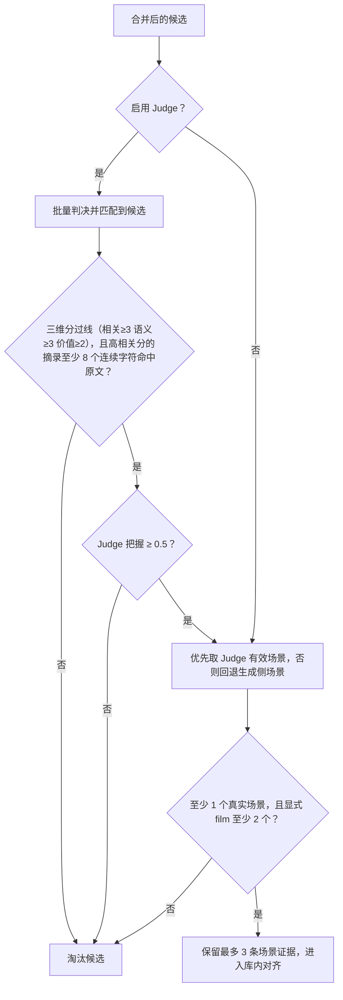
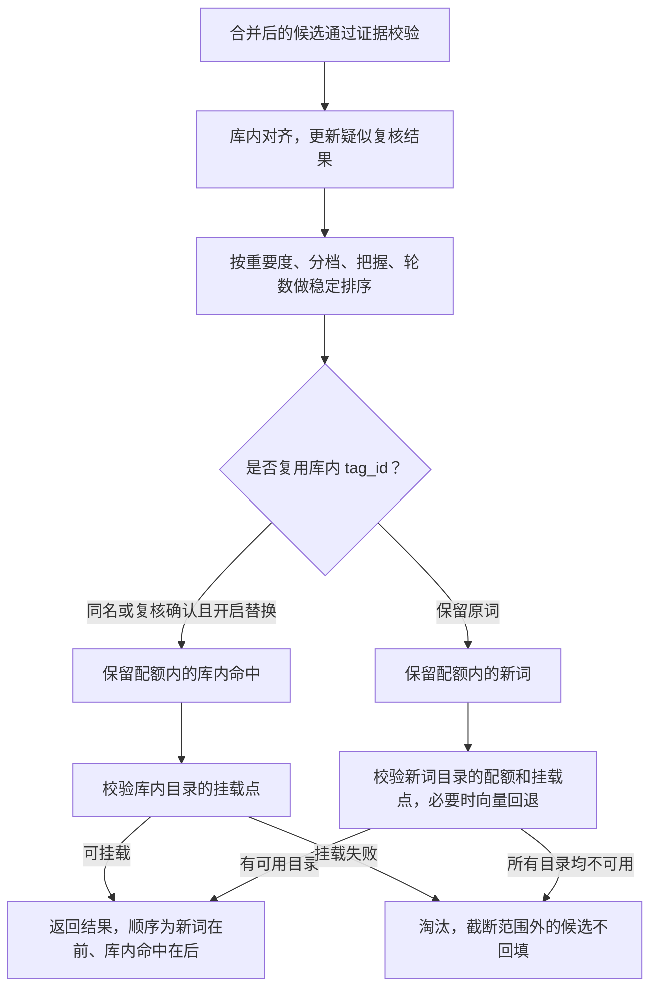

# 开放标签生成算法详解

当前 `mode=open` 使用 `mtg-v11-target-directory`。本文从 `run_open_generation()` 读取影片识别内容开始，讲到输出带证据、目录和挂载点的 `ProducedTag`。文中使用仓库默认值，`Settings` 中的参数可通过 `TAGPLT_` 环境变量覆盖，`policy` 随任务传入。 [算法入口](../src/tagplatform/generation/mtg/pipeline.py) · [默认配置](../src/tagplatform/settings.py)

## 1. 算法总图



## 2. 准备材料与两轮生成

| 材料 | 怎样构造 |
| --- | --- |
| 影片背景 `script` | 片名、摘要（最多 600 字符）和人物介绍。逐场请求按出场 ID、说话人及人物情绪匹配相关人物，兼容角色名及别名。全片生成使用完整人物表。 |
| 场景文本 `script` | 场景 ID、起止毫秒、描述（最多 240 字符）、氛围、人物情绪、地点和音乐等可用字段。 |
| 台词 `dialogue` | 每条已保存的台词跟随所属场景文本。台词渲染依赖 `script`。 |
| 画面 `video` | 按场景找已有关键帧。优先查导入资产的帧目录，缺帧时查 MovieNet 对应片段。默认每场 2 张、全片最多 24 张，先走一遍能取到帧的场景，各给 1 张，再按同一顺序补第 2 张。每张图片附场景 ID，和文字放进同一个多模态请求。 |
| 已有词提示 | 用任务目录范围及其子目录内的有效标签名建向量索引，排除停用项及模板占位词。查询端分别编码非空剧情摘要和各场景描述。每个库词取它与全部查询文本的**最大余弦相似度**，按该分数选前 30 个，只在影片级请求给出召回的库词名称，提示「不要原样重复输出」，允许更精确的说法。 |
| 动态目录提示 | 取任务范围内允许新增词的目录，按全路径与目录 ID 排序，默认最多给 60 条，每条带目录 ID、全路径和适用粒度。 |

默认启用三种模态，生成使用 `qwen3.7-plus`，温度 `0.7`。

1. **第一轮逐场提炼**。按资产场景顺序串行调用。每次给片名、摘要和本场相关人物作为背景，再给当前场景的文本、台词和关键帧作为证据，并附可扩展目录清单。模型围绕片段搜索提取本场可核验、自然且有区分度的标签，并从可扩展目录中选择适用目录。有目录清单时，**目录定义决定本轮找哪一类特征**：提示里的具体词（如「无声对峙」）只是命名颗粒度示例，核心含义不属于所选目录的细节即使有证据也不输出。多场影片每场最多 1 条。单场资产最多 3 条，同时受任务预算限制。
2. **第二轮影片级综合**。一条请求带全片文本、同一批关键帧、按片序组织的逐场候选和库词、目录提示。每场都保留一条 `scene_id` 记录，即使没有候选。`tags` 中包含标签名、理由和释义。提示要求找前后呼应、反复出现的意象和人物变化，允许发现第一轮之外的特征，并为每条标签引用至少两个真实场景；同样只能取目录定义所指那一类特征，不属于这一类的人物变化、意象主题或事件不输出。多场影片共发出「场景数 + 1」次生成请求。只有一个场景时只做第一轮。

### 标签预算

- 每个来源（新词、库内命中）的上限为 `K = min(mtg_max_final_tags, policy.max_tags)`，默认 15。整个任务的总上限为 `T = min(policy.max_tags, 2 × K)`，默认 30。
- 多场影片的场景级产出上限为 `S = min(场景数, 5, max(1, floor(T / 3)))`。第一轮候选都交给第二轮，也都可以参与合并和 Judge，最后按排序选出至多 `S` 条场景级标签。
- 全片候选上限为 `max(1, min(T, mtg_max_candidates_per_run) - S)`。默认候选预算为 20，有至少 5 场的影片最多生成 15 条影片级候选，最终最多保留 5 条场景级标签。少量场景释放的名额可供影片级候选使用。总上限为 1 时两轮各可提出候选，最终只选 1 条。证据不足时模型可返回空数组。

两轮使用同一个 JSON 结构。

```json
{
  "tags": [
    {
      "tag": "多线叙事",
      "scope": "film",
      "dir": "可扩展目录的 ID",
      "scenes": ["scene_001", "scene_004"],
      "reason": "开场交替呈现记者调查和失踪者家属寻人，两组人物各自获得线索。后续再以同一份车票串起两条线，说明两条情节线先分别推进、再发生交汇。",
      "desc": "由两条或多条情节线交替或并行展开的叙事方式"
    }
  ]
}
```

`scope` 由请求阶段确定。模型明确返回另一层级时丢弃该项，省略层级时按本阶段处理。场景级候选须引用本场 ID，影片级候选须引用至少两个真实场景 ID。候选名称去首尾空白后须非空且最多 20 字符，请求内部按名称的 `casefold()` 去重，通过阶段校验后按原输出顺序应用上限。生成的 `reason` 去首尾空白后完整保留，送审时合并内部换行。

无法解析的单次响应按空候选处理。所有调用均无法解析，或有生成调用失败时，任务失败。合规的空 `tags` 表示该请求未发现可支撑的候选。 [提示与材料](../src/tagplatform/generation/mtg/prompts.py) · [关键帧](../src/tagplatform/generation/mtg/keyframes.py) · [库词召回](../src/tagplatform/generation/mtg/catalog_align.py) · [输出解析](../src/tagplatform/generation/mtg/parse.py)

## 3. 合并场景级和影片级候选

### 3.1 名称归一去重

对每个原始词用 `name.casefold()` 做大小写折叠，再只留 `isalnum()` 为真的字符。空格、标点和其他非字母数字字符被去掉，中文保留。比如「多线 叙事」与「多线·叙事」的键都是「多线叙事」。键相同的候选直接合并，保留第一次出现的表述，收集原始名称、去重后的轮次与场景 ID，累计维度、层级和目录票数，保留这一组首个非空理由和首个非空释义。影片级候选先进入合并，因此同名时优先采用它的理由和释义。

### 3.2 向量化与聚类

默认用 **`BAAI/bge-m3`** 编码各组的归一键，调用角色为 `query`。本地后端经 Sentence Transformers 编码，BGE-M3 接收纯文本。嵌入输出做 L2 归一化，因此单位向量的点积等于余弦相似度。阶段内只编码名称，`reason`、`desc` 与场景内容不参与聚类相似度计算。

对所有不同名称组两两计算相似度，按相似度从高到低检查。每组初始自成一簇。候选对低于 **0.75** 时可停止遍历。候选对过线且分属两簇时，仅当两簇之间的**每一对成员**都满足余弦 ≥ 0.75，才合为一簇。这是 complete-link 的合并条件。只有一个名称组时直接生成一簇，无需做向量聚类。

例如 A–B 的余弦是 0.84，B–C 是 0.80，A–C 是 0.68。先合并 A、B，之后检查 `{A, B}` 与 C 时，A–C 未过线，C 继续单独成簇。

### 3.3 聚类后的字段怎么取

| 字段 | 取法 |
| --- | --- |
| 代表词 | 在簇内按归一组出现过的**不同轮数**降序、原始名称长度升序、首次出现位置升序选一组，用该组首次出现的表述。 |
| 理由与释义 | 取代表组的首个非空 `reason` 和 `desc`。 |
| `scenes`、`runs`、名称变体 | 场景取去重并集并按 ID 排序，轮数按全簇覆盖的生成轮次计数，保留簇内去重后的原始名称。第一轮的所有场景调用属于同一轮。 |
| `dimension`、`scope`、`dir` | 分别按簇里非空声明票数取多数。维度同票取统计顺序先遇到的值，层级同票取 `film`，目录同票取字典序最小值。 |

[归一、聚类和字段合并](../src/tagplatform/generation/mtg/merge.py) · [嵌入器及归一化](../src/tagplatform/embed/embedding.py)

## 4. Judge 三维评分、原文校验与场景证据

### 4.1 Judge 看什么、输出什么

默认用 **`deepseek-v4.1-flash`，温度 0**，一条请求批量评审所有聚类后的代表词。候选清单给出代表词、维度、层级、场景 ID 和完整的生成理由。影片材料给出摘要、人物、场景描述、氛围和人物情绪等结构化文本，台词开启时按场景提供台词。Judge 使用文本材料，**结果导向**地逐条评标签的实际效果（mtg-v6 起，取代旧版 supported/importance 二值判定）：

| 输出字段 | 语义或取值 |
| --- | --- |
| `relevance` | 内容支持度 0–4：0 内容反驳或无相关对象；1 只有相关话题；2 核心有据但限定缺失或全片证据集中同一事件；3 核心及限定可一步推理推出、证据覆盖层级；4 可直接定位。影片级 ≥3 须至少两个独立场景。 |
| `semantics` | 名称清晰度 0–4（此阶段释义尚未补写，只评名称本身）：0 无法解读；1 指代含糊；2 边界模糊有歧义；3 清晰无歧义可独立理解；4 区分条件自明。 |
| `value` | 实际作用 0–4：0 脱离剧情无法解读；1 存在性/情节编号/泛泛评价；2 普通类目；3 场景级恰一项有效限定或影片级形成具体观影预期；4 场景级 ≥2 项独立限定或影片级形成鲜明、能与同类区分的预期。 |
| `confidence` | Judge 对**自身评分**的把握，解析时限制在 0–1。非数值按 0。 |
| `dir_fits` | 按候选的目标目录 ID 给出布尔判决。目标包括合法的模型目录和可能用到的向量备选。候选没有目标目录时省略。 |
| `quote`、`scenes`、`reason` | 要求摘录 10–25 字原文，给出有关场景 ID，并说明评分依据。`relevance` 核对影片材料，缺少必要证据时允许显式 `null`。`semantics` 和 `value` 按名称评分，均须返回 0–4 整数。 |

评分先按归一名称精确匹配，剩余条目再尝试唯一前缀匹配。识别错名、漏判、非法分数、证据字段结构错误和漏判目录后，只重试待补候选。各轮已匹配的合法结果保留；仍未判的候选淘汰，整片没有有效评分才中断。目录漏判不作语义否定，但该目录不能用于新增标签。

每次 Judge 调用的原始响应、解析错误与末轮兜底条数写进审计的 `judge_trace`（`raw` / `errors` / `salvaged`），失败路径同样落盘——整片产出归零时可据此分清是模型显式 `null`、漏字段还是响应格式漂移。

### 4.2 代码如何决定留不留



1. **查原文**。对 `relevance >= 3` 的评分，把摘录和生成侧的影片文本各自去掉空白和指定标点。摘录每滑动 1 位取一个 8 字符窗口，只要有一个窗口能在文本中连续命中就通过。整个摘录的每个字无需都对应。搜索底本是生成侧按当前模态渲染的**整段文本**，包括可用摘要和场景描述等，也不要求摘录落在所报场景的描述里。未命中时把 `relevance` 降档到 1（理由记「摘录未命中原文」），自然过不了保留阈值。
2. **过分数阈值**。只接收有匹配评分、`relevance >= 3` 且 `semantics >= 3` 且 `value >= 2`、`confidence >= 0.5` 的候选；任一维为 `null` 按未过线淘汰（不猜分放行）。阈值与 0.5 都是代码常量，`policy.min_confidence` 不参与开放算法。关闭 Judge 时跳过评分和引用检查，结果置信度用 0.8。
3. **取真实场景**。先用资产里的场景 ID 表过滤 Judge 返回的 ID，场景级额外限定在候选来源场景。至少有一个有效 ID 时，只用 Judge 侧的有效场景。Judge 没给有效 ID 时才回退合并后的生成侧场景并集。按顺序去重，最多保留 3 个，填入真实 ID、起止毫秒和前 120 字符的场景描述。
4. **检查概括层级**。所有候选至少要有 1 个有效场景。合并后显式为 `film` 的候选至少要有 2 个不同场景。例如，生成侧给了两个场景、Judge 只给了一个真实场景时，全片级候选仍会被淘汰。

[Judge 提示词与文本](../src/tagplatform/generation/mtg/prompts.py) · [判决匹配与重试](../src/tagplatform/generation/mtg/judge.py) · [原文与证据校验](../src/tagplatform/generation/mtg/pipeline.py)

## 5. 库内对齐与疑似同义复核

### 5.1 用完整范围索引分档

对齐遍历的是**任务目录范围内的全部有效库词**。默认提示里的前 30 个词只是从该索引召回的子集。模型可能输出未列出来的库词，也可能复述已列出的词，因此后处理仍有同名分支。

每个候选用原始代表词做 `query` 编码，库词索引用名称做 `passage` 编码。先计算与全部库词的余弦，并找向量最近的一项，再依次执行以下规则。先命中的规则决定分档和对齐对象。

| 优先级 | 条件 | 结果 |
| --- | --- | --- |
| 1 | 归一后的候选名等于归一后的库词名 | `duplicate`，使用该词的规范名和 `tag_id`。有多个同名词时，取字典序最小的 `tag_id`。 |
| 2 | 候选原始名称包含某个不同的库词原名，且库词至少 2 字符 | `suspect`，匹配最长的被包含词。例如「悬疑解谜」包含「悬疑」。 |
| 3 | 与**向量最近的库词**的字符集合 Jaccard ≥ 0.40 | `suspect`，匹配最近库词。Jaccard = 共有不同字符数 ÷ 两个词合计不同字符数。 |
| 4 | 与**向量最近的库词**的余弦 ≥ 0.74 | `suspect`，匹配最近库词。 |
| 5 | 以上都未命中 | `new`，没有可用于复用的 `tag_id`。 |

`relevance_score` 保留的是向量最近项的余弦，按同名或包含规则命中的规范词有时是另一项。该分数衡量候选对库内名称的相似度。有库目录、但当前范围没有有效库词时，对齐为空，候选排序按新词档处理，分数留空。 [库词索引](../src/tagplatform/library.py) · [分档规则](../src/tagplatform/generation/mtg/catalog_align.py)

### 5.2 疑似对子如何确认

默认开启复核，将「候选原词、匹配库词、最近项相似度」组为一对。按进入疑似列表的顺序，在同一次请求里发前 **40 对**，使用与 Judge 同一模型，温度 **0**，默认输出上限 **8192 tokens**。提示要求判断「两个词都进标签库，审核者会不会认为只该保留一条」。例如「非线性叙事／线性叙事」字面虽像，概念相反，应判 `same=false`。复核按返回的候选原名回填结果。解析失败尝试一次格式重试，请求失败返回空复核结果。

| 复核结果 | 后续处理 |
| --- | --- |
| `same=true` | 若开启替换且有匹配的 `tag_id`，输出库内规范词，原候选名可作为别名。关闭替换时保留原词和疑似档。同义复核通过的候选仍以 `suspect` 参与排序。 |
| `same=false` | 更新为 `new`，保留原词，在同重要度下获得新词优先级。 |
| 无判定 | 包括超出 40 对、模型漏回、复核失败或关闭复核。保留 `suspect` 和原词，进入新词队列。 |

同名候选直接指向库内词，疑似替换开关只控制复核确认同义的分支。 [同义复核请求与解析](../src/tagplatform/generation/mtg/verify.py) · [复核结果应用](../src/tagplatform/generation/mtg/pipeline.py)

## 6. 排序和截断



1. 对通过证据校验的候选做稳定排序，依次比较 **Judge 价值分**（`value` 高者优先）、**库内分档**（`new > suspect > duplicate`）、**Judge 把握**、**出现轮数**，四项均从高到低。四项完全一样时沿用合并候选的输入顺序。
2. 按排序遍历候选，同时检查总上限 `T`、当前来源上限 `K` 和场景级上限 `S`。符合配额的候选按是否复用库内 `tag_id` 放入对应队列。结果仍按新词、库内命中的顺序输出，队列内保留排序结果。
3. 最后检查目录、单目录配额和挂载点。目录或挂载检查淘汰的名额不回填，因此最终产出可低于预算。 [排序、分队与截断](../src/tagplatform/generation/mtg/pipeline.py)

## 7. 归属目录、挂载点与释义

新词只能采用 `dir_fits` 明确为 true 的实际落点。目录结果为 false 或漏判时，该目录不可用于新增；回退检查各备选自己的结论。已确认的库内复用沿用库内标签目录。

- **库内命中**沿用库词所属目录。按目录粒度解析实际挂载点，解析失败则淘汰。
- **新词先试模型目录**。策略须允许新词且标签库可用。模型给的目录可解析为 ID、完整路径或唯一目录名。依次检查在不在本次范围、是否为动态目录、是否超过新词单目录配额，以及能否解析到挂载点。默认单目录不限额。
- **再试向量兜底**。以候选名称为查询，目录文本由目录名、描述和最多 12 个有效库词示例组成。按余弦降序取前 5 个动态目录，逐个检查配额与挂载，使用第一个合格目录。这里按相似度排序，没有额外的最低分门槛。所有备选都不合格时淘汰。
- **按目录粒度挂载**。`content` 取影片资产 ID，`scene` 取证据中的第一个有效场景 ID，`character` 合并证据场景里的人物 ID，去重后恰好一个才能挂载。目录自身声明有效时采用该值，缺失时沿父链查找，最终回退到 `content`。候选的 `film/scene` 概括层级仍只决定前文的证据数量要求。
- **补释义**。新词已有的 `desc` 若通过校验就保留。校验会清洗空白和首尾格式，要求 9–32 字符，排除片名、角色名、场景编号及「本片」等措辞。其余候选用生成模型批量补写，提供标签名和可用目录路径。最多尝试 2 次，单次有至少一条合格释义即返回该批结果，未补上的留空。

[目录向量与回退](../src/tagplatform/library.py) · [挂载点解析](../src/tagplatform/mounting.py) · [释义校验与补写](../src/tagplatform/generation/mtg/descriptions.py)

## 8. 算法输出与单条追踪

`ProducedTag` 中，库内命中携带规范名和 `tag_id`，保留原候选名作为可选别名；库外新词携带原词、维度、目录和可选释义。两者都附置信度、场景证据和实际挂载点，有库内对齐时同时附向量最近项的相似度。

定位某条词的去向，可在 `data/audit/mtg/<task_id>.json` 依次查 `runs[].tags`（逐轮名称）与 `runs[].scenes`（第一轮逐场候选）、`merged`（代表词与名称变体）、`verdicts`（三维评分、目录契合及摘录）、`library.align`（分档理由与复核结果）、`library.truncated`（超出队列配额）、`dropped`（淘汰原因）、`accepted`（最终候选及目录来源）和 `judge_trace`（Judge 逐次原始响应与解析错误）。 [输出与报告字段](../src/tagplatform/generation/mtg/pipeline.py)

查看逐场生成、影片级生成及后续模型阶段的模板、完整输入和原始响应。 [自动采集的提示词样本](open-tag-prompts/README.md)
