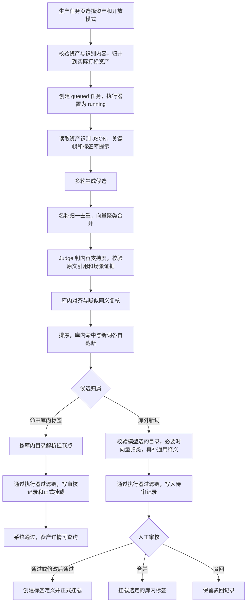
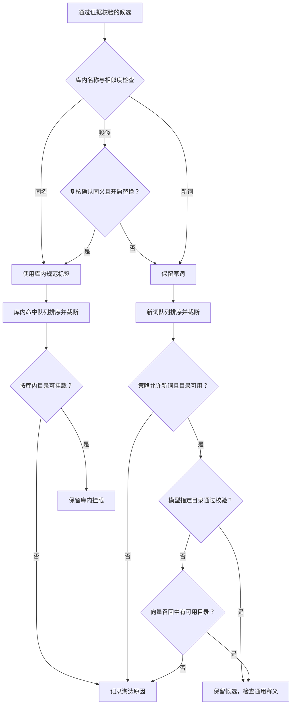

# 开放标签生成流程详解

本文按 `feat/open-tag-tuning` 分支的 `490f515` 实现梳理平台的开放生成链路。生产任务选择 `mode=open` 后，由 `OpenTagProducer` 调用 `run_open_generation()`，成功任务在 `prompt_version` 中记录 `mtg-v3`。下文参数为仓库默认值，运行实例可通过 `TAGPLT_` 环境变量覆盖。

## 1. 总流程

## 2. 任务入口与运行上下文

1. 在「生产任务」页创建任务，选择已完成内容识别的资产。前端提交 `POST /api/v1/generation/tasks`，包含 `asset_ids`、`mode: "open"` 和可选 `policy`。当前表单提供 `max_tags` 和 `min_confidence` 两项策略输入，API 还接受目录范围、新词开关和单目录配额。
2. API 查找资产的 `content_json`。场景子资产通常没有独立的识别 JSON，服务沿父链找到最近一个有内容的祖先，再按目标资产去重。选中同一部影片及其多个场景时，对该影片只建一个任务，使用整份影片识别内容。未知资产返回 `404`，资产与父链都无识别内容或模式未注册时返回 `422`。整批通过校验后才创建任务。
3. 执行器把任务从 `queued` 置为 `running`，读取内容和策略，加载 `tag_catalog` / `tag_define` 的标签库视图，再把这些数据和模型客户端交给生产器。默认使用两个后台 worker，设为 `0` 时同步执行。开放生产器由代码构造多段提示词，运行时绕过数据库里的活动模板，所以修改「模型配置」页的开放模板不会改变这条链路。

入口与分发见 [生产任务页](../frontend/src/pages/GenerationTasks.tsx)、[生成任务 API](../src/tagplatform/api/routers/generation.py)、[执行器](../src/tagplatform/tasks/runner.py)和 [开放生产器](../src/tagplatform/generation/open_gen.py)。

## 3. 准备材料并多轮生成

| 材料 | 当前取法 |
| --- | --- |
| 影片与场景文本 | 使用片名、摘要（最多 600 字符）、前 8 位角色，以及所有场景的 ID、时间、描述（每场最多 240 字符）、氛围、人物情绪、地点和音乐等可用字段。开启 `dialogue` 时附上资产中已有的台词。`script` 关闭时，整个文本块为空，台词也随之省略。 |
| 关键帧 | `video` 开启时按场景查找已有图片，优先查导入资产的帧目录，缺帧时找 MovieNet 对应片段。默认每场最多 2 张、全片合计最多 24 张，先按场景顺序分配第一张再分配第二张。图片按场景 ID 标记后附在请求中。找不到帧时继续用现有文字材料。 |
| 已有标签提示 | 在策略允许的目录及其子目录内建立库内标签名向量索引，排除停用项和模板占位词。用摘要及各场景描述查询，每个标签取所有查询中的最高相似度，默认给模型前 30 个标签名，提示避免原样复述，可给出更精确的说法。后续实际对齐使用整个范围内的索引。 |
| 可扩展目录提示 | 从同一策略范围取允许新增标签的动态目录，按全路径排序后默认最多给 60 个，包含目录 ID、全路径和适用粒度。提示不含目录时，生成无需填写 `dir`。 |

默认生成模型为 `qwen3.7-plus`，温度 `0.7`。同一任务默认顺序调用 3 轮，各轮使用同一份内容材料和提示要求，解析后每轮最多收 20 条候选。多轮输出取并集，因此只出现一次、但有足够内容支持的标签也能留下。

提示词要求从**风格、情绪、主题、叙事、角色**五个维度提炼中文短语。结构化输出包含标签名 `tag`、维度 `dimension`、概括层级 `scope`、场景 ID 列表 `scenes`、本片依据 `reason` 和通用释义 `desc`。有目录提示时同时要求填写目录 `dir`。提示词要求每轮 15–20 条、标签 2–8 字、场景级最多 5 条等，属于模型输出指引。解析器实际会清理字段，去掉空名、超过 20 字符的名称及轮内重复名。单轮解析异常按空轮处理，所有轮次均无可解析候选时任务失败，任一生成请求返回失败也会使任务失败。

实现见 [提示词与材料渲染](../src/tagplatform/generation/mtg/prompts.py)、[关键帧定位](../src/tagplatform/generation/mtg/keyframes.py)、[输出解析](../src/tagplatform/generation/mtg/parse.py)和 [库内提示召回](../src/tagplatform/generation/mtg/catalog_align.py)。

## 4. 跨轮合并

1. 先把名称做大小写折叠并去掉空白和标点，按归一名合并。例如「多线叙事」与「多线 叙事」会直接归到一组。组内汇总出现轮次、场景 ID、名称变体和字段投票。
2. 对归一后的不同名称做向量化，默认使用 `BAAI/bge-m3`。按余弦相似度做 complete-link 聚类，默认阈值 `0.75`。两簇只有在所有交叉成员对都过线时才合并。例如 A 与 B 接近、B 与 C 接近时，A 与 C 仍要过线才能三者归成一簇。
3. 代表词按出现轮数多、名字短、首次出现早依次选择。保留代表词的理由和释义，汇总全簇的场景 ID 与去重后的轮次。维度、概括层级和模型目录取簇内多数；`film` 与 `scene` 并列时取 `film`，目录并列时按字典序取第一项。

实现见 [候选合并](../src/tagplatform/generation/mtg/merge.py)。

## 5. Judge 与证据校验

默认由 `deepseek-v4.1-flash` 以温度 `0` 批量判断合并后的候选。输入包含代表词、维度、生成侧的短理由，以及影片文本。Judge 的影片材料保留场景描述、氛围、人物情绪等字段，省略图片和台词行。判决包含支持状态、重要度、把握程度、引用场景、原文摘录和判定理由。程序先按归一名对齐判决，未对齐的判决再尝试唯一前缀匹配。

| 检查 | 留下候选的条件 |
| --- | --- |
| 支持状态 | 有对应判决且为 `supported`。`insufficient` 表示证据不足，`contradicted` 表示内容与标签矛盾。 |
| 原文引用 | 去掉空白和指定标点后，Judge 摘录必须有至少 8 个连续字符出现在**生成侧按当前模态渲染的文本**中。搜索范围是整段文本。引用匹配失败会把 `supported` 降为 `insufficient`。 |
| 判定把握 | Judge 的 `confidence` 至少为 `0.5`。关闭 Judge 时跳过判决检查，结果置信度回退为 `0.8`，场景证据校验照常运行。 |
| 场景证据 | 优先用 Judge 返回的有效场景 ID，若一个有效 ID 都没有，再回退到生成侧的场景并集。去重后至少保留一个真实场景，最多留 3 个。显式 `scope=film` 的候选至少需要 2 个不同场景。 |

证据记录从识别 JSON 取真实场景 ID、起止毫秒和前 120 字符的场景描述，供任务详情与审核页面查看。Judge 的原文摘录保存在审计报告的判决里，页面证据描述展示的是场景原描述。它们各自回答「Judge 引用了什么」和「可以回到影片的哪一段」。

`policy.min_confidence` 在开放流程中未参与上述判定。当前固定阈值衡量的是 Judge 对自身结论的把握。Judge 响应解析失败会补充格式要求再试一次，仍失败则任务失败，请求返回失败时直接失败。候选漏判、证据不够等在单条候选层面淘汰。

实现见 [Judge 请求与判决匹配](../src/tagplatform/generation/mtg/judge.py)、[证据校验与流水线](../src/tagplatform/generation/mtg/pipeline.py)。

## 6. 库内对齐、排序与目录归属

### 6.1 对齐与疑似同义复核

对每条过证据校验的候选，按以下顺序检查库内标签，命中第一条规则即停。

1. **同名 `duplicate`**。归一名精确命中时使用库内规范名与 `tag_id`。多个库内标签同名时，按 `tag_id` 取稳定的一条。
2. **疑似 `suspect`**。候选名包含长度至少为 2 的库内名称时，取最长的命中名称。否则检查向量最相近的库内标签，字符集合 Jaccard 重合度至少 `0.40` 或向量余弦至少 `0.74` 时标记为疑似。
3. **新词 `new`**。其余候选进入新词档。没有可用的库内标签索引时，排序也按新词档处理。

默认把疑似对子批量交给复核模型判断是否是同一概念。例如候选「悬疑解谜」包含库内词「悬疑」，是否可以互换由复核判断。确认同义且开启替换才换成库内规范名，原生成词作为别名交给执行器登记。明确判为不同概念后升入新词档。复核失败、漏判或关闭复核时保留原词和疑似档。`relevance_score` 存的是候选与库内向量最近项的余弦相似度，有时最近项与按名称命中的项不同。没有索引时该字段为空。

### 6.2 队列排序与截断

顺序依次为 **Judge 重要度**（`core` > `secondary` > `incidental`）、**分档**（新词 > 疑似 > 同名）、**Judge 把握**、**不同轮次出现次数**，各项均由高到低。命中库内规范词和继续作为新词的候选各自取前 `min(mtg_max_final_tags, policy.max_tags)` 条，默认每组最多 15 条。因此两组都有足够候选时，截断后的合计上限是 30 条。目录和挂载检查在截断后执行，候选在这一步淘汰时，截断之外的候选不会回填。

### 6.3 决定目录和挂载点

- **库内命中**沿用库内标签所属目录，按其 `applicable_scope` 解析挂载点。无法挂载时淘汰。
- **库外新词**需要 `allow_new_tags=true` 和可用的动态目录。先把模型给的 `dir` 按 ID、全路径或唯一目录名解析，检查是否在范围内、是否允许新增、单目录剩余配额及挂载点。无法采用时，以候选名向量查询目录向量，依相似度依次尝试前 5 个动态目录。目录向量由目录名、描述及最多 12 个已有标签示例构成。找不到合格目录时淘汰。

| 目录有效粒度 | `target_id` 的取值 |
| --- | --- |
| `content` | 当前任务资产的 `asset_id`。 |
| `scene` | 证据中第一个有效 `scene_id`。 |
| `character` | 合并证据场景的角色 ID 去重后，必须恰好得到一个角色。 |

目录自身的有效声明优先，缺失时沿父链寻找，最终回退到 `content`。模型的 `scope=film/scene` 用于判断概括跨度和证据数量，实际挂到影片、场景还是人物由目录粒度决定。

### 6.4 通用释义

对通过目录与挂载检查的新词，保留合格的 `desc`。程序用长度与关键词规则检查释义，清洗后要求 9–32 字符，并筛掉片名、人名、场景 ID 或「本片」等指代。缺失或不合格的释义由生成模型批量补写，补写失败或仍不合格则留空。释义用于说明这个词本身代表的特征，影片中的支持材料由场景证据记录。

实现见 [对齐规则](../src/tagplatform/generation/mtg/catalog_align.py)、[同义复核](../src/tagplatform/generation/mtg/verify.py)、[目录向量索引](../src/tagplatform/library.py)、[挂载解析](../src/tagplatform/mounting.py)和 [释义校验](../src/tagplatform/generation/mtg/descriptions.py)。

## 7. 落库、重跑与人工审核

生产器返回 `ProducedTag`，执行器依次调用质量评估与信息围栏。这两个环节当前都是透传实现。随后以资产和任务来源清掉旧的 `pending` 行，再按资产、挂载对象、库内 `tag_id` 或新词名查重。相同键已有记录时跳过，保留既有终审结果和其他来源占用的记录。对同一资产成功重跑后，较早任务详情可能少掉后来被替换的待审候选。

| 生产器产出 | 写入 `pre_asset_tag` | 写入 `asset_tag` |
| --- | --- | --- |
| `catalog`（库内命中） | 带库内 `tag_id`、评分和证据，系统自动标记 `approved`，审核人为 `system`。疑似同义自动并入时留存原候选名，执行器会尝试登记为库内别名。 | 同步写入正式挂载，已有同键挂载时跳过。 |
| `generated`（库外新词） | 带候选名、候选目录、释义、评分、证据及挂载点，状态为 `pending`。 | 人工通过或修改后通过时，创建或复用定义、回填 `tag_id` 并挂载。人工也可合并到现有定义，或驳回并只保留审核记录。 |

数据库里的 `pre_asset_tag.origin` 记录任务模式 `open`，上述 `catalog/generated` 是流水线内部区分「命中库内」和「库外候选」的值。生成结果与任务成功状态一起提交，执行异常会回滚未提交的结果并记录 `failed`。候选全部被筛掉时，任务仍可正常完成，结果为空。人工审核先提交审核状态，随后写标签定义及正式挂载。如果后一阶段失败，可能出现已通过但资产详情尚未显示的记录，失败原因写入服务日志。

实现见 [过滤链](../src/tagplatform/filtering/__init__.py)、[生成结果入库](../src/tagplatform/results.py)和 [人工审核服务](../src/tagplatform/review/service.py)。

## 8. 查结果与定位候选去向

| 要查什么 | 去哪里查 |
| --- | --- |
| 任务状态、模型、流程版本和已落库候选 | 生产任务页展开详情，或读 `GET /api/v1/generation/tasks/{task_id}`。失败任务可用 `POST /api/v1/generation/tasks/{task_id}/retry` 重新提交。 |
| 仅看资产上已经生效的标签 | 资产详情或 `GET /api/v1/assets/{asset_id}/tags`，数据来自正式挂载表 `asset_tag`。 |
| 某标签在哪一步被合并、截断或丢弃 | 查看 `data/audit/mtg/<task_id>.json`。重点看 `runs`（逐轮候选名）、`merged`（代表词与簇）、`verdicts`（判决与摘录）、`dropped`（淘汰原因）、`library.truncated`（配额截断）及 `accepted`（通过流水线的候选及目录来源）。`accepted` 在执行器落库前写出，查重后的实际结果以任务详情为准。 |
| 查调用成本 | 同一报告中的 `usage`、`judge_usage`、`verify_usage`、`descriptions.usage` 和 `elapsed_s` 分别记录各阶段调用量及流水线总耗时。审计写入失败会记日志，较早中断的任务也可能没有完整报告。 |

任务策略默认 `max_tags=30`、`dir_ids=[]`（全库）、`allow_new_tags=true`、`max_tags_per_dir=0`（新词单目录不限额）。流程参数和开关集中在 [Settings](../src/tagplatform/settings.py)。常用覆盖项包括 `TAGPLT_MTG_RUNS`、`TAGPLT_MTG_MODALITIES`、`TAGPLT_MTG_MAX_FINAL_TAGS`、`TAGPLT_MTG_JUDGE_ENABLED`、`TAGPLT_OPEN_DIR_HINT_MAX` 和 `TAGPLT_MTG_REPORT_DIR`。关闭 `TAGPLT_OPEN_LIBRARY_ENABLED` 会同时移除库内对齐与新词归属所需的目录视图，库外候选会因无处归属被淘汰。
