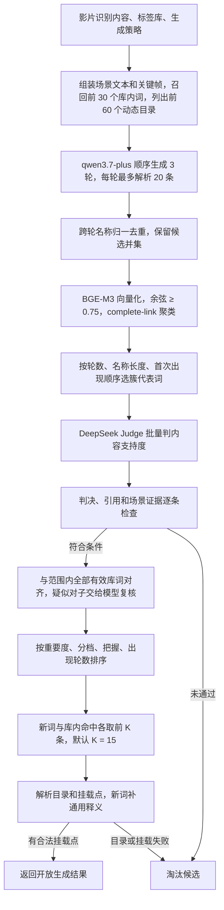
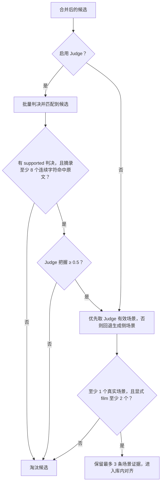
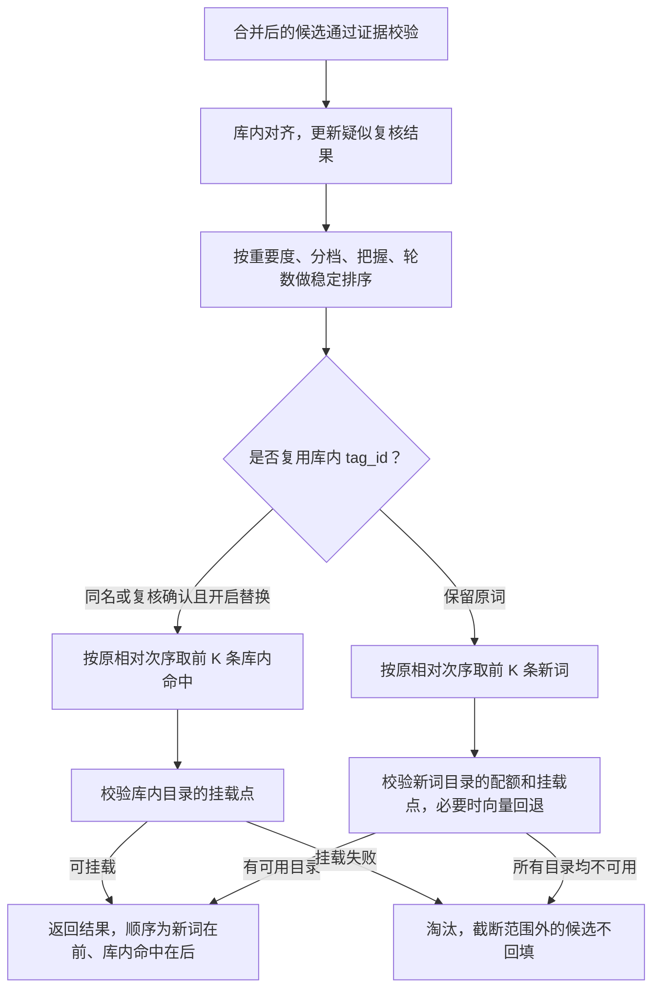

# 开放标签生成算法详解

当前 `mode=open` 使用 `mtg-v3`。本文从 `run_open_generation()` 读取影片识别内容开始，讲到输出带证据、目录和挂载点的 `ProducedTag`。文中使用仓库默认值，`Settings` 中的参数可通过 `TAGPLT_` 环境变量覆盖，`policy` 随任务传入。 [算法入口](../src/tagplatform/generation/mtg/pipeline.py) · [默认配置](../src/tagplatform/settings.py)

## 1. 算法总图



## 2. 准备材料并顺序生成三轮

| 材料 | 怎样构造 |
| --- | --- |
| 场景文本 `script` | 片名、摘要（最多 600 字符）、前 8 位角色，以及每场的 ID、起止毫秒、描述（最多 240 字符）、氛围、人物情绪、地点和音乐等可用字段。 |
| 台词 `dialogue` | 加入识别 JSON 中已保存的台词。文本渲染依赖 `script`，关掉 `script` 时台词也不会拼进去。 |
| 画面 `video` | 按场景找已有关键帧。优先查导入资产的帧目录，缺帧时查 MovieNet 对应片段。默认每场 2 张、全片最多 24 张，先走一遍能取到帧的场景，各给 1 张，再按同一顺序补第 2 张。每张图片附场景 ID，和文字放进同一个多模态请求。 |
| 已有词提示 | 用任务目录范围及其子目录内的有效标签名建向量索引，排除停用项及模板占位词。查询端分别编码非空剧情摘要和各场景描述。每个库词取它与全部查询文本的**最大余弦相似度**，按该分数选前 30 个，只把名称交给模型，提示「不要原样重复输出」，允许更精确的说法。 |
| 动态目录提示 | 取任务范围内允许新增词的目录，按全路径与目录 ID 排序，默认最多给 60 条，每条带目录 ID、全路径和适用粒度。 |

默认启用三种模态。生成使用 `qwen3.7-plus`，温度 `0.7`。按 `max(1, mtg_runs)` 顺序调用，默认 **3 轮**。各轮提示内容相同，轮次下标不参与提示组装。每轮都重新生成候选，随后取跨轮并集。一个候选出现一次即可参与后续流程。

每轮提示模型从风格、情绪、主题、叙事、角色五个维度提炼有证据的特征，优先选择能体现影片特色、帮助观众形成观影预期的标签。证据充足时目标为 **15–20 条**（全片级至少 10 条），证据不足时按实际可支撑的数量输出。输出结构类似：

```json
{
  "tags": [
    {
      "tag": "多线叙事",
      "scope": "film",
      "dimension": "叙事",
      "dir": "可扩展目录的 ID",
      "scenes": ["scene_001", "scene_004"],
      "reason": "开场交替呈现记者调查和失踪者家属寻人，两组人物各自获得线索。后续再以同一份车票串起两条线，说明两条情节线先分别推进、再发生交汇。",
      "desc": "由两条或多条情节线交替或并行展开的叙事方式"
    }
  ]
}
```

`scope=film` 表示全片级概括，提示要求至少两个不同场景共同支撑。场景级允许单场支撑，每场最多贡献一条、合计最多五条。`tag` 用 2–8 字命名特征，`desc` 给出可跨片复用的定义，`scenes` 引用实际提供的场景 ID，`reason` 用一到两句写清可核对的细节以及这些细节为何支持标签。有目录提示时要求填写 `dir`。

解析阶段实际按**原输出顺序**最多取 20 条有效项，名称去首尾空白后须非空且最多 20 字符，轮内按名称的 `casefold()` 去重。维度和层级转成约定值，无法识别时留空。生成的 `reason` 去首尾空白后完整保留，送审时合并段内换行，保持候选清单一条一行。单轮解析异常按空轮处理，三轮均无可解析项时中断。任一生成请求返回失败也会中断。 [提示与材料](../src/tagplatform/generation/mtg/prompts.py) · [关键帧](../src/tagplatform/generation/mtg/keyframes.py) · [库词召回](../src/tagplatform/generation/mtg/catalog_align.py) · [输出解析](../src/tagplatform/generation/mtg/parse.py)

## 3. 跨轮去重和语义聚类

### 3.1 名称归一去重

对每个原始词用 `name.casefold()` 做大小写折叠，再只留 `isalnum()` 为真的字符。空格、标点和其他非字母数字字符被去掉，中文保留。比如「多线 叙事」与「多线·叙事」的键都是「多线叙事」。键相同的候选直接合并，保留第一次出现的表述，收集原始名称、去重后的轮次与场景 ID，累计维度、层级和目录票数，保留这一组首个非空理由和首个非空释义。

### 3.2 向量化与聚类

默认用 **`BAAI/bge-m3`** 编码各组的归一键，调用角色为 `query`。本地后端经 Sentence Transformers 编码，BGE-M3 接收纯文本。嵌入输出做 L2 归一化，因此单位向量的点积等于余弦相似度。阶段内只编码名称，`reason`、`desc` 与场景内容不参与聚类相似度计算。

对所有不同名称组两两计算相似度，按相似度从高到低检查。每组初始自成一簇。候选对低于 **0.75** 时可停止遍历。候选对过线且分属两簇时，仅当两簇之间的**每一对成员**都满足余弦 ≥ 0.75，才合为一簇。这是 complete-link 的合并条件。只有一个名称组时直接生成一簇，无需做向量聚类。

例如 A–B 的余弦是 0.84，B–C 是 0.80，A–C 是 0.68。先合并 A、B，之后检查 `{A, B}` 与 C 时，A–C 未过线，C 继续单独成簇。

### 3.3 聚类后的字段怎么取

| 字段 | 取法 |
| --- | --- |
| 代表词 | 在簇内按归一组出现过的**不同轮数**降序、原始名称长度升序、首次出现位置升序选一组，用该组首次出现的表述。 |
| 理由与释义 | 取代表组的首个非空 `reason` 和 `desc`。 |
| `scenes`、`runs`、名称变体 | 场景取去重并集并按 ID 排序，轮数按全簇不同轮次计数，保留簇内去重后的原始名称。 |
| `dimension`、`scope`、`dir` | 分别按簇里非空声明票数取多数。维度同票取统计顺序先遇到的值，层级同票取 `film`，目录同票取字典序最小值。 |

[归一、聚类和字段合并](../src/tagplatform/generation/mtg/merge.py) · [嵌入器及归一化](../src/tagplatform/embed/embedding.py)

## 4. Judge 判决、原文校验与场景证据

### 4.1 Judge 看什么、输出什么

默认用 **`deepseek-v4.1-flash`，温度 0**，一条请求批量判定所有聚类后的代表词。候选清单给出代表词、维度、前 40 字符的生成理由。影片材料给出摘要、人物、场景描述、氛围和人物情绪等结构化文本，去掉台词行，省略关键帧。Judge 需要基于影片材料逐条判断：

| 输出字段 | 语义或取值 |
| --- | --- |
| `verdict` | `supported` 有明确支持，`insufficient` 依据不足，`contradicted` 明显矛盾。不认识的判决值按 `insufficient` 处理。 |
| `importance` | `core` 主要特征、`secondary` 局部但清晰、`incidental` 一笔带过。用于排序，未知值按 `secondary`。 |
| `confidence` | Judge 对**自身判定**的把握，解析时限制在 0–1。非数值按 0。 |
| `quote`、`scenes`、`reason` | 要求摘录 10–25 字原文，给出有关场景 ID，并说明摘录如何支持判定。对全片概括，提示 Judge 只有单场支撑时判证据不足。 |

判决先按归一名称精确匹配，剩余条目再尝试唯一前缀匹配，每个候选最多接收一个判决。候选漏判在单条层面淘汰。整批输出解析失败时补充格式要求重试一次，仍失败则中断。Judge 请求返回失败时直接中断。

### 4.2 代码如何决定留不留



1. **查原文**。对 `supported` 判决，把摘录和生成侧的影片文本各自去掉空白和指定标点。摘录每滑动 1 位取一个 8 字符窗口，只要有一个窗口能在文本中连续命中就通过。整个摘录的每个字无需都对应。搜索底本是生成侧按当前模态渲染的**整段文本**，包括可用摘要和场景描述等，也不要求摘录落在所报场景的描述里。未命中时改判为 `insufficient`。
2. **过判定阈值**。只接收有匹配判决、状态仍为 `supported` 且 `confidence >= 0.5` 的候选。这里的 0.5 是代码常量，`policy.min_confidence` 不参与开放算法。关闭 Judge 时跳过判决和引用检查，结果置信度用 0.8。
3. **取真实场景**。先用资产里的场景 ID 表过滤 Judge 返回的 ID。至少有一个有效 ID 时，只用 Judge 侧的有效场景。Judge 没给有效 ID 时才回退合并后的生成侧场景并集。按顺序去重，最多保留 3 个，填入真实 ID、起止毫秒和前 120 字符的场景描述。
4. **检查概括层级**。所有候选至少要有 1 个有效场景。合并后显式为 `film` 的候选至少要有 2 个不同场景。例如，生成侧给了两个场景、Judge 只给了一个真实场景时，全片级候选仍会被淘汰。缺少有效 `scope` 的候选只执行至少一场的检查，构造输出时其 `level` 回退为 `film`。

[Judge 提示词与文本](../src/tagplatform/generation/mtg/prompts.py) · [判决匹配与重试](../src/tagplatform/generation/mtg/judge.py) · [原文与证据校验](../src/tagplatform/generation/mtg/pipeline.py)

## 5. 库内对齐与疑似同义复核

### 5.1 用完整范围索引分档

对齐遍历的是**任务目录范围内的全部有效库词**。默认提示里的前 30 个词只是从该索引召回的子集。模型可能输出未列出来的库词，也可能复述已列出的词，因此后处理仍有同名分支。

每个候选用原始代表词做 `query` 编码，库词索引用名称做 `passage` 编码。先计算与全部库词的余弦，并找向量最近的一项，再依次执行以下规则。先命中的规则决定分档和对齐对象。

| 优先级 | 条件 | 结果 |
| --- | --- | --- |
| 1 | 归一后的候选名等于归一后的库词名 | `duplicate`，使用该词的规范名和 `tag_id`。有多个同名词时，取字典序最小的 `tag_id`。 |
| 2 | 候选原始名称包含某个不同的库词原名，且库词至少 2 字符 | `suspect`，匹配最长的被包含词。例如「悬疑解谜」包含「悬疑」。 |
| 3 | 与**向量最近的库词**的字符集合 Jaccard ≥ 0.40 | `suspect`，匹配最近库词。Jaccard = 共有不同字符数 ÷ 两个词合计不同字符数。 |
| 4 | 与**向量最近的库词**的余弦 ≥ 0.74 | `suspect`，匹配最近库词。 |
| 5 | 以上都未命中 | `new`，没有可用于复用的 `tag_id`。 |

`relevance_score` 保留的是向量最近项的余弦，按同名或包含规则命中的规范词有时是另一项。该分数衡量候选对库内名称的相似度。有库目录、但当前范围没有有效库词时，对齐为空，候选排序按新词档处理，分数留空。 [库词索引](../src/tagplatform/library.py) · [分档规则](../src/tagplatform/generation/mtg/catalog_align.py)

### 5.2 疑似对子如何确认

默认开启复核，将「候选原词、匹配库词、最近项相似度」组为一对。按进入疑似列表的顺序，在同一次请求里发前 **40 对**，使用与 Judge 同一模型，温度 **0**，默认输出上限 **8192 tokens**。提示要求判断「两个词都进标签库，审核者会不会认为只该保留一条」。例如「非线性叙事／线性叙事」字面虽像，概念相反，应判 `same=false`。复核按返回的候选原名回填结果。解析失败尝试一次格式重试，请求失败返回空复核结果。

| 复核结果 | 后续处理 |
| --- | --- |
| `same=true` | 若开启替换且有匹配的 `tag_id`，输出库内规范词，原候选名可作为别名。关闭替换时保留原词和疑似档。同义复核通过的候选仍以 `suspect` 参与排序。 |
| `same=false` | 更新为 `new`，保留原词，在同重要度下获得新词优先级。 |
| 无判定 | 包括超出 40 对、模型漏回、复核失败或关闭复核。保留 `suspect` 和原词，进入新词队列。 |

同名候选直接指向库内词，疑似替换开关只控制复核确认同义的分支。 [同义复核请求与解析](../src/tagplatform/generation/mtg/verify.py) · [复核结果应用](../src/tagplatform/generation/mtg/pipeline.py)

## 6. 排序和截断



1. 对通过证据校验的候选做稳定排序，依次比较 **Judge 重要度**（`core > secondary > incidental`）、**库内分档**（`new > suspect > duplicate`）、**Judge 把握**、**出现轮数**，四项均从高到低。四项完全一样时沿用合并候选的输入顺序。
2. 按是否复用库内 `tag_id` 分到「新词」与「库内命中」两个队列，保留各自在上一步的相对次序。两队各取前 `K = min(mtg_max_final_tags, policy.max_tags)`，默认 `min(15, 30) = 15`。默认截断后最多 **15 条新词 + 15 条库内命中**，依次处理新词队列与命中队列。
3. 最后才检查目录、单目录配额和挂载点。被拒的名额不回填到各自队列，所以最终数量可以低于截断数量，甚至为零。新词队列的单目录配额也不会消耗库内命中队列的名额。

例如把 K 设为 2，有 3 条新词和 3 条库内命中，则初步各留 2 条。如果留下的一条新词无法找到可挂载目录，该组最后只输出 1 条，排第 3 的新词不会补进来。 [排序、分队与截断](../src/tagplatform/generation/mtg/pipeline.py)

## 7. 归属目录、挂载点与释义

- **库内命中**沿用库词所属目录。按目录粒度解析实际挂载点，解析失败则淘汰。
- **新词先试模型目录**。策略须允许新词且标签库可用。模型给的目录可解析为 ID、完整路径或唯一目录名。依次检查在不在本次范围、是否为动态目录、是否超过新词单目录配额，以及能否解析到挂载点。默认单目录不限额。
- **再试向量兜底**。以候选名称为查询，目录文本由目录名、描述和最多 12 个有效库词示例组成。按余弦降序取前 5 个动态目录，逐个检查配额与挂载，使用第一个合格目录。这里按相似度排序，没有额外的最低分门槛。所有备选都不合格时淘汰。
- **按目录粒度挂载**。`content` 取影片资产 ID，`scene` 取证据中的第一个有效场景 ID，`character` 合并证据场景里的人物 ID，去重后恰好一个才能挂载。目录自身声明有效时采用该值，缺失时沿父链查找，最终回退到 `content`。候选的 `film/scene` 概括层级仍只决定前文的证据数量要求。
- **补释义**。新词已有的 `desc` 若通过校验就保留。校验会清洗空白和首尾格式，要求 9–32 字符，排除片名、角色名、场景编号及「本片」等措辞。其余候选用生成模型批量补写，提供标签名和可用目录路径。最多尝试 2 次，单次有至少一条合格释义即返回该批结果，未补上的留空。

[目录向量与回退](../src/tagplatform/library.py) · [挂载点解析](../src/tagplatform/mounting.py) · [释义校验与补写](../src/tagplatform/generation/mtg/descriptions.py)

## 8. 算法输出与单条追踪

`ProducedTag` 中，库内命中携带规范名和 `tag_id`，保留原候选名作为可选别名；库外新词携带原词、维度、目录和可选释义。两者都附置信度、场景证据和实际挂载点，有库内对齐时同时附向量最近项的相似度。

定位某条词的去向，可在 `data/audit/mtg/<task_id>.json` 依次查 `runs[].tags`（逐轮名称）、`merged`（代表词与名称变体）、`verdicts`（判决及摘录）、`library.align`（分档理由与复核结果）、`library.truncated`（超出队列配额）、`dropped`（淘汰原因）和 `accepted`（最终候选及目录来源）。 [输出与报告字段](../src/tagplatform/generation/mtg/pipeline.py)

查看四个模型阶段的模板、完整输入和原始响应。 [自动采集的提示词样本](open-tag-prompts/README.md)
