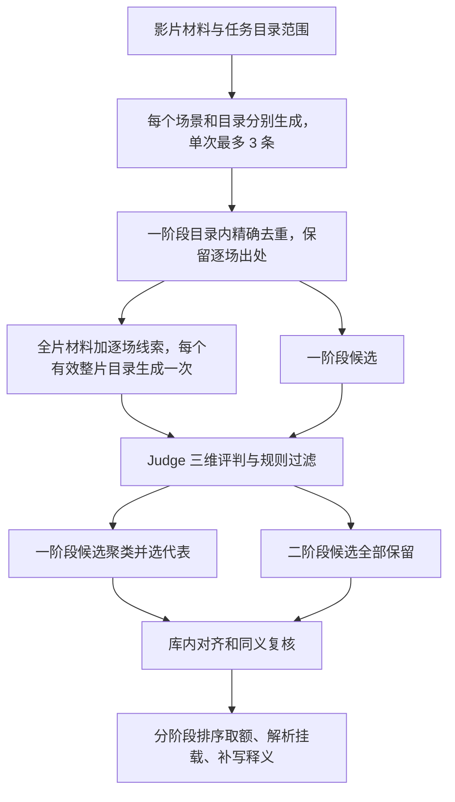

# 开放标签生成算法详解

开放生成使用 `mtg-v15-unified-verdict`。输入是影片识别材料、标签库和任务策略。输出标签带有来源、证据、目录和挂载点，由生产执行器写入审核队列或复用库内标签。 [算法入口](../src/tagplatform/services/generation/open/mtg/pipeline.py) · [默认配置](../src/tagplatform/settings.py)

## 两阶段生成

| 材料 | 构造方式 |
| --- | --- |
| 剧本和台词 | 片名、摘要、人物、场景描述、起止时间、氛围、情绪、地点和音乐等可用字段。已保存的台词随场景提供，渲染依赖剧本文本模态。 |
| 关键帧 | 按场景取已有帧。默认每场最多 2 张，整部影片最多 24 张，每张附场景 ID。 |
| 已有词 | 默认给二阶段召回最相关的 30 个库词。库词索引覆盖任务目录范围内有效、非占位的标签。 |
| 目标目录 | 遍历任务范围及其子目录内允许扩充的动态目录和资产目录。每次请求只给当前目标目录。 |

一阶段逐场逐目录请求。模型只需根据当前场景和目录定义提出标签名、通用释义和证据理由，程序绑定目录与来源场景。每个场景、每个目录最多 3 条。阶段结束后，按目录和去除首尾空白后的名称精确去重，保留重复词出现过的所有场景。不同目录同名的候选，以及同一目录里的 `AI` 和 `ai`，均分别保留。

二阶段每个有效适用范围包含 `content` 的目录单独请求一次，每次最多 5 条，每条须引用至少两个真实场景。使用全片材料、已启用的关键帧和全部一阶段逐场线索。同名词即使只合并为一条送审候选，二阶段仍能在每个来源场景下看到该词及理由。纯 `scene`、纯 `character` 目录以及单场景素材只参加一阶段。多场景影片的生成请求数为 `场景数 × 可扩充目录数 + 二阶段目录数`。

合法的空候选数组表示本次没有发现足够证据。单次响应无法解析时，保留其余请求的候选。生成调用报错或所有响应都无法解析时，任务失败。没有可扩充目录或任务只允许复用时，继续使用已有词补全入口。 [生成与证据处理](../src/tagplatform/services/generation/open/mtg/directory_candidates.py) · [提示组装](../src/tagplatform/services/generation/open/mtg/prompts.py)

## 评判、聚类与库内对齐

Judge 默认每批最多 20 条，逐个候选编号返回判决，并与开放评测评审共用同一套三维评价标准、融合输出协议与判决引擎（`capabilities/prompts/_evaluation.py` + `mtg/verdicts.py`）。送审候选携带生成阶段产出的通用释义、来源场景、标签种类（由目标目录 `applicable_scope` 决定：内容级 / 场景级 / 人物级）以及目标目录路径与定义。漏判时重试待补候选，保留已有判决；全部候选都没有有效判决时，任务失败。 [Judge 分批和判决对齐](../src/tagplatform/services/generation/open/mtg/judge.py)

Judge 不再单独返回 `dir_fits` 目录契合布尔值，而是将标签与目标目录的匹配程度融合进语义准确性（`semantics`）标准，与名称清晰度、释义一致性一并评定 0–4 分。标签价值（`value`）由模型对内容呈现（`presentation`）、内容搜索（`search`）、内容推荐（`recommendation`）三个方向分别打 0–4 整数分，再由程序按标签种类权重聚合为保留两位小数的 0.00–4.00 价值分（默认权重：内容级 `0.30/0.40/0.30`、场景级 `0.50/0.40/0.10`、人物级 `0.55/0.30/0.15`，支持 `TAGPLT_TAG_VALUE_WEIGHTS_*` 环境变量覆盖）。

通过条件为内容相关性（`relevance`）至少 3 分、语义准确性（`semantics`）至少 3 分、加权标签价值（`value`）至少 2.0 分，由共用引擎 `verdict_pass` 复算。原文摘录须有连续 8 个清洗后字符可在当前模态文本中匹配；relevance 高分判决另须通过场景计数核验（全片级 ≥2、场景级 ≥1），任一不满足 relevance 压 1，压分淘汰记专属原因（如「高相关分无逐字摘录支撑」），核验只认判决自引证据，不回落生成侧场景。一阶段只在来源场景内核验。证据采用有效的 Judge 场景，缺失时采用有效的生成场景，最多保存 3 个。二阶段至少需要 2 个有效场景。

两阶段都完成评判和过滤后，向量化通过的一阶段标签名称，归一化后做 K-means。目标为 `floor(场景数 × 目录数 / 3)` 簇，有候选时至少 1 簇，实际簇数受候选数和不同向量数限制。每簇选距离中心最近的原词，保留该词的目录与证据。聚类覆盖各目录，二阶段通过项直接进入库内对齐。

库内对齐先计算与最近库词的余弦相似度，再按以下顺序判定。

1. 归一名称相同，直接复用库内词。同名词超过一个时，取字典序最小的 `tag_id`。
2. 候选名称包含不同的库词原名，且该库词至少两个字符，标为疑似，匹配最长的被包含词。
3. 候选与向量最近库词的字符集合 Jaccard 相似度达到 0.40，标为疑似。
4. 候选与向量最近库词的余弦相似度达到 0.75，标为疑似。
5. 其余作为新词处理。

疑似同义词每批最多复核 40 对。模型确认同义且替换开关开启时，采用规范名，原词可记为别名。其他结果保留原词。 [库内对齐](../src/tagplatform/services/generation/open/mtg/catalog_align.py) · [疑似复核](../src/tagplatform/services/generation/open/mtg/verify.py)

## 排序、配额和审计

两阶段各自按 Judge 价值降序、最近库词余弦相似度升序排名。同分同相似度时沿用候选顺序。没有可比库词时，同价值候选也沿用候选顺序。一阶段最多 `min(10, 场景数 × 2)` 条，二阶段最多 5 条。任务总额更紧或两个阶段落到同一条待入库记录时，二阶段优先，一阶段可以用下一条补位。

库内复用按库词目录挂载。新词归入请求绑定的目录，受任务的新词单目录上限约束。组合范围按证据可解析的最细粒度挂载。挂载失败的候选不占阶段名额。缺少合格通用释义的新词在产出前补写。 [挂载点解析](../src/tagplatform/services/tags/mounting.py)

审计用 `runs` 记录两阶段的原始候选和逐目录请求，用 `merged` 记录送审候选，用 `verdicts` 和 `judge_trace` 记录判决和原始响应。候选编号串起 `dropped` 的淘汰原因、`clustering` 的簇成员和代表、`library.truncated` 的配额淘汰及 `accepted` 的最终去向。评测漏斗单列聚类后的保留数。 [提示词样本](open-tag-prompts/README.md)
