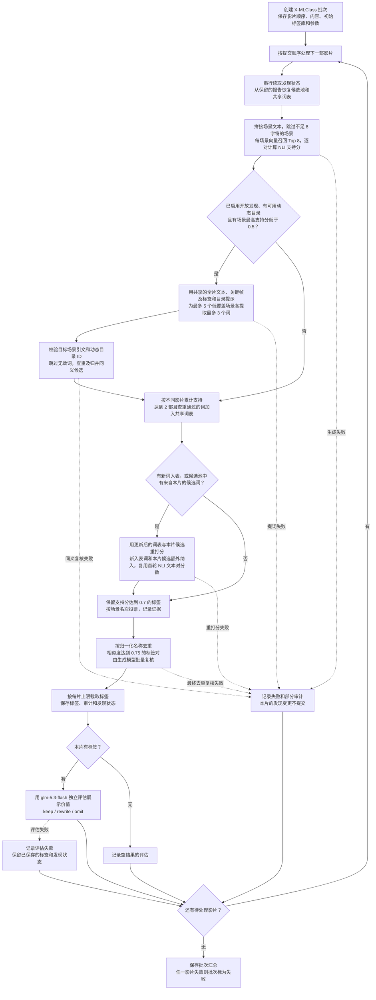

# 在线 X-MLClass 评测

「算法基准」页面固定运行 `x-mlclass-online-v1`。每部影片先用本地 NLI 匹配工作词表中的标签。只有覆盖不足的场景才可能触发开放提词。影片标签经过排序和去重后，交给独立评估模型评估展示价值。评测产生的新词保存在报告的候选池和共享词表中。正式标签生成的 `open` 模式使用 MTG-v3。

## 启动评测

1. 安装算法依赖 `pip install -e ".[xmlclass]"`，沿用部署的真实嵌入器和生成模型。NLI 模型默认在 CPU 上运行，首次评分时加载。离线部署可预先下载模型和 tokenizer，并用 `TAGPLT_XMLCLASS_NLI_MODEL` 指定本地路径。
2. 在「算法基准」选择影片、设置每片标签上限和独立评估提示词，点击「生成并自动评估」。批次创建时保存影片内容、标签库和评测算法参数，按影片提交顺序逐片运行。
3. 展开影片查看场景证据、词表变化、生成分段耗时和评估理由，也可以导出完整报告。

通过 API 创建批次时，显式指定算法。

```text
POST /api/v1/benchmarks
{"algorithm":"x-mlclass-online-v1","asset_ids":["film1","film2"],"max_tags":15}
```

与 MTG-v3 对照时，在各自实例提交相同影片及顺序，使用相同的初始标签库、关键帧配置、生成模型、嵌入器、标签上限和评估提示词。两个实例独立保存结果。`shared-materials-dedup-v1` 表示批次使用共用的生成素材渲染和最终去重逻辑。

## 一部影片怎么生成标签



图中的阈值为默认值。同义归并仅在需要语义复核时调用大模型。整条生成路径没有调用大模型时，生成 token 为 0。独立评估的 token 单独统计。

1. **准备工作词表和场景文本。** 用本批标签库快照中有效的标签初始化词表，保留标签 ID、释义和别名，再从保留的报告恢复已累积的发现。静态目录的已有标签也参与匹配。场景文本由描述、视觉特征、台词、事件、实体、情绪等识别信息组成。场景 ID 和时间戳用于定位，文本少于 8 个字符的场景默认跳过。
2. **向量召回，再用 NLI 评分。** 每个场景默认召回 8 个最相近的标签名称。本地 NLI 将场景文本与「这个场景包含{label}。」配对，分别计算每对的蕴含概率作为支持分。默认输入预算为 2048 token，超长输入截断场景文本并保留标签假设。覆盖判断取每个场景的最高支持分。
3. **仅对低覆盖场景做开放发现。** 最高支持分**低于 0.5** 才进入发现队列，按支持分从低到高，每片最多 5 个场景，每场景最多 3 个关键词。生成模型收到全片文本、按场景标记的关键帧、相关标签提示和可扩展目录。新词必须填写本轮列出的 `dir_dynamic` 目录 ID，并引用目标场景发给模型的描述或台词中的连续原文，至少 8 个字符。没有可用动态目录时跳过提词，目录或引文校验失败时跳过该词。
4. **同义归并、累积支持，再对新词评分。** 先用归一化后的名称和别名查工作词表，再比较候选池代表词。向量近似的词只进入复核，由大模型确认同义后合并。通过校验的新词当片就能参与评分。支持数按不同影片的 `asset_id` 计算，同片多场景或重复跑同片都只算一部。默认至少有 2 部影片支持，且通过工作词表查重，才纳入共享词表，供后续影片召回。本片的候选词和新入表的词会进入第二轮评分，即使没有进入向量召回前 8 名。重复的场景与标签文本对复用首轮 NLI 分数。
5. **按场景排序投票，再去重和截取。** 每个场景先剔除支持分低于 `0.7` 的标签，再按支持分排序。各场景按第一名、第二名等位置逐列投票。票数并列时按最高支持分、标签键排序，最高票只有一票时该列只取一项。标签置信度取它在支持场景中的最高分，并附场景 ID 和时间区间。算法基准的证据描述与共享提示中的场景描述一致，保留前 240 个字符。最终先按归一化名称去重，再把余弦相似度达到 `MTG_MERGE_THRESHOLD`（默认 `0.75`）的标签对一起交给生成模型复核。确认重复后保留排序靠前的标签，最后按每片上限截取。

本实现直接用初始标签库初始化词表，通过低覆盖场景在线发现新词。论文原版采用 GMM 初始化、全语料预提词和独立的关键词投票。 [在线发现设计](online-label-discovery-design.md) · [论文分析](x-mlclass-paper-analysis.md)

## 独立评估

生成结果和发现状态先保存，再由固定的 `glm-5.3-flash` 按 `viewer-quality-v3` 评估。评估模型收到影片文本和最终标签名，逐条判为 `keep`（可直接展示）、`rewrite`（建议改写）或 `omit`（不建议展示）。同义的 `keep` 项按规范概念去重。可展示占比等于去重后的可展示概念数除以本片受评标签数。改写建议供查看，报告保留算法输出的原标签。创建批次时可自定义评估提示词。

## 生成 token 为什么可能为 0

「生成 token」合计生成模型三类调用的用量，即**开放提词、同义复核、最终去重的语义复核**。向量召回和本地 NLI 的开销体现在耗时和 NLI 文本对数里。独立评估单独统计 token 和耗时。实际发生的生成模型调用如果缺少用量，影片行显示「未知」。

如果所有场景的最高支持分都达到 `0.5`，就无需开放提词。如果最终也没有达到相似度门槛的标签对，就无需调用模型复核。这时生成 token 为 `0`，影片仍可通过召回、评分和投票得到标签。

例如一次使用 GYT360 标签集的评测中，《Rear Window》的 15 个场景均达到覆盖门槛，最终得到 5 个库内标签，生成 token 为 `0`，独立评估用了 31,439 token。《12 Years a Slave》有一个场景最高支持分约为 `0.410`，一次开放提词用了 32,015 个生成 token。未触发提词的影片也可能产生生成 token，这笔用量来自最终去重时的大模型复核。

## 报告与发现状态

报告保存在 `MTG_REPORT_DIR` 下的 `benchmarks` 目录。每部影片开始生成时，候选池和共享词表根据仍保留的 X-MLClass 报告重建。恢复新词时要求其归属目录仍有效且为 `dir_dynamic`。删除已完成或失败的报告会移除该报告贡献的发现证据。已入表词失去部分证据后，如果支持数跌破门槛，就回到候选池。失去全部来源的词从发现状态移除。

多个批次的发现状态按影片串行读取和提交。提词、同义复核、NLI 或最终去重失败时，当前影片保留审计，发现状态沿用上一次已保存的结果，批次继续处理后面的影片。独立评估失败时，已保存的标签和发现状态仍可查看。任一影片失败会使批次标为失败。重启时服务会标记中断的批次，后续批次可继承已保存的发现证据。

## 配置

所有名称均加环境变量前缀 `TAGPLT_`，例如 `TAGPLT_XMLCLASS_MIN_SUPPORT_DOCUMENTS=2`。

| 配置                              | 默认值                              | 含义                                                |
| --------------------------------- | ----------------------------------- | --------------------------------------------------- |
| `XMLCLASS_NLI_MODEL`              | `MoritzLaurer/bge-m3-zeroshot-v2.0` | 模型 ID 或本地目录                                  |
| `XMLCLASS_NLI_DEVICE`             | `cpu`                               | PyTorch 设备                                        |
| `XMLCLASS_NLI_BATCH_SIZE`         | 32                                  | NLI 批大小                                          |
| `XMLCLASS_NLI_MAX_LENGTH`         | 2048                                | 成对输入最大 token 数，换用短窗口模型时按其限制配置 |
| `XMLCLASS_NLI_HYPOTHESIS`         | `这个场景包含{label}。`             | 标签假设模板                                        |
| `XMLCLASS_RECALL_TOP_K`           | 8                                   | 每场景召回标签数                                    |
| `XMLCLASS_LOW_COVERAGE_THRESHOLD` | 0.5                                 | 发现所用最高支持分阈值                              |
| `XMLCLASS_MIN_LABEL_SUPPORT`      | 0.7                                 | 排名与证据的最低支持分                              |
| `XMLCLASS_MIN_SCENE_CHARS`        | 8                                   | 可用场景最少字符数                                  |
| `XMLCLASS_MAX_DISCOVERY_SCENES`   | 5                                   | 每片发现预算，0 关闭发现                            |
| `XMLCLASS_KEYWORDS_PER_SCENE`     | 3                                   | 每场景关键词数上限                                  |
| `XMLCLASS_MIN_SUPPORT_DOCUMENTS`  | 2                                   | 加入跨任务共享工作词表所需的不同影片数              |
| `XMLCLASS_SYNONYM_COSINE`         | 0.75                                | 同义判断短名单阈值                                  |
| `XMLCLASS_SYNONYM_TOP_K`          | 3                                   | 每个词最多复核的代表词数                            |
| `OPEN_LIBRARY_ENABLED`            | `true`                              | 启用标签库辅助的开放发现                            |
| `OPEN_DIR_HINT_MAX`               | 60                                  | 最多列出的动态目录数，0 关闭开放提词                |
| `MTG_MERGE_THRESHOLD`             | 0.75                                | 最终去重中进入模型复核的标签对相似度门槛            |

NLI 的用途和标签映射见[作者模型卡](https://huggingface.co/MoritzLaurer/bge-m3-zeroshot-v2.0)和[模型配置](https://huggingface.co/MoritzLaurer/bge-m3-zeroshot-v2.0/blob/main/config.json)。排名投票参考 [X-MLClass 作者实现](https://github.com/Kaylee0501/X-MLClass/blob/main/OpenWordMLTC/zero-shot/model_eval.py)。
